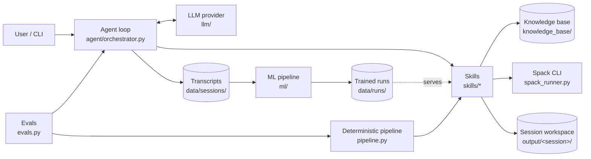

# Architecture

spack-ai turns software (a source tree, a single build file, or a URL) into what an HPC
user needs to build it with Spack: a `package.py` recipe, a `spack.yaml` environment, and
a batch build script. It also diagnoses failed builds.

## Overview



The idea that ties it together is that **every capability is a skill**. A skill is a typed,
validated, self-documenting function. Three callers share the same skills:

1. **The agent.** Claude chooses which skill to call next, so it can handle messy,
   open-ended requests.
2. **The deterministic pipeline.** It chains the skills in a fixed order with no LLM
   (`spack-ai generate`). This gives a free baseline, an offline mode, and what the evals
   score by default.
3. **Tests and evals.** They call skills directly.

## Components

### Skills (`src/spack_ai/skills/`)

Each subpackage contains one or more `Skill` subclasses plus an optional `SKILL.md` playbook.

| Skill | Category | What it does |
|---|---|---|
| `list_source_tree`, `read_source_file` | inspection | Look at the code (sandboxed to the trees the user passed) |
| `fetch_source` | inspection | Download a tarball (with sha256) or clone a repo. *Asks first* |
| `analyze_build_system` | analysis | Detect CMake/Autotools/Makefile/Meson/Python, extract deps, options, languages |
| `map_dependencies` | analysis | Upstream names → Spack packages/virtuals (curated table → trained model → guess) |
| `draft_package_recipe` | generation | BuildSpec → `PackageRecipe` → rendered `package.py` in a local Spack repo |
| `save_package_recipe` | generation | Write a model-authored `package.py` and run static checks |
| `generate_environment` | generation | `spack.yaml` with local repo, externals, requirements |
| `generate_job_script` | generation | Slurm/PBS/LSF/bash script that concretizes and installs |
| `validate_recipe` | validation | Static checks, plus `spack spec` when Spack is installed |
| `diagnose_build_failure` | troubleshooting | Match logs against `error_patterns.yaml` |
| `search_knowledge` | knowledge | BM25 search over the knowledge base |
| `spack_command` | spack | Run Spack. Read-only commands run freely, the rest *ask first* |

Skill contract (`skills/base.py`):

- `Input`: a pydantic model. Its JSON schema becomes the tool definition, and every call
  is validated against it before `run()` executes. Invalid input goes back to the model
  as an error it can correct.
- `run(params) -> SkillResult`: a summary, data, files, and warnings, serialized as JSON
  for the model.
- `requires_confirmation` / `confirmation_prompt()`: the approval gate for actions that
  change state or touch the network.
- `SkillContext`: settings, the session workspace, path sandboxing
  (`resolve_source`, `resolve_output`), lazy access to the knowledge base and Spack, and
  `state`, a blackboard where one skill leaves results for the next. For example, the
  BuildSpec from analysis feeds drafting without making a round trip through the model.

**Adding a skill:** create `skills/<name>/skill.py` with a `@register`-decorated `Skill`
subclass, import it from `skills/<name>/__init__.py`, and optionally add a `SKILL.md`. The
registry discovers subpackages automatically. Add a test.

### Analysis → recipe data flow (`schemas.py`)

```text
source tree ──analyze──▶ BuildSpec ──map──▶ BuildSpec (spack names) ──build──▶ PackageRecipe ──render──▶ package.py
                                                                   └──────▶ EnvironmentSpec ──render──▶ spack.yaml
```

- **Analyzers** (`skills/build_analysis/`) are static, heuristic parsers, one per build
  system, behind a common `Analyzer` interface. They record *where* each dependency was
  found and under which upstream condition (`if(ENABLE_MPI)`, `ifeq ($(USE_HDF5),1)`,
  `required: get_option('cairo')`).
- **The mapper** (`skills/dependency_mapping/`) resolves names in this order:
  the curated table (`knowledge_base/structured/dependency_map.yaml`), then a trained
  model if one is configured, then an explicitly flagged guess.
- **The builder** (`skills/recipe/builder.py`) turns options into variants, upstream
  conditions into `when=` clauses, adds language and build-tool dependencies, and
  generates Makefile `edit()` rewrites.
- **The renderer** (`skills/recipe/render.py` + `templates/package.py.j2`) emits idiomatic
  code: `define_from_variant`, `enable_or_disable`/`with_or_without`, `FileFilter`.
  Unknowns become `# FIXME` comments. It never invents checksums.

### Agent (`src/spack_ai/agent/`)

- `orchestrator.py`: the tool-use loop. It sends the stable system prompt, history, and
  tool definitions to the provider, validates and runs requested skills (all results of
  one turn go back in a single message), enforces approval gates, and stops cleanly on
  `refusal`, on truncated tool calls, and at `max_turns`.
- `prompts.py`: assembles the system prompt from fixed principles, site facts, knowledge
  base sections, and skill playbooks. It is deterministic so that it can be prompt-cached.
- `session.py`: an append-only JSONL transcript per session, plus `feedback` events.
  These transcripts are the ML training data.

### LLM providers (`src/spack_ai/llm/`)

The agent only knows the `LLMProvider` protocol (`llm/base.py`). `AnthropicProvider`
implements it for Claude (`claude-opus-5-5` by default). It uses adaptive thinking, an
explicit effort level, server-side refusal fallback, prompt caching of the system prompt
and conversation, streamed tool inputs (validated before execution), and append-only
history. A locally served fine-tuned model can be added as another provider without
touching the agent.

### Knowledge base (`knowledge_base/`, `src/spack_ai/knowledge/`)

Markdown and code files are organized in sections, chunked by heading, and searched with
BM25 (pure Python, offline). `Retriever` is a protocol, so an embedding or hybrid
retriever can be swapped in once the corpus is large. `structured/` holds YAML tables
that skills load directly. See `knowledge_base/README.md`.

### ML framework (`src/spack_ai/ml/`)

See `src/spack_ai/ml/README.md`. In short:

```text
data/sessions/*.jsonl ─┐
spack-packages repo ───┴─▶ collectors ─▶ Dataset (JSONL) ─▶ Trainer(TrainableModel) ─▶ data/runs/<run>/
                                                                                         │
                                       map_dependencies (ml.dependency_model) ◀──────────┘
```

### Safety boundaries

- **Reading:** only the trees passed with `--path`, fetched sources, and the session
  workspace (`SkillContext.resolve_source`).
- **Writing:** only inside the session workspace (`resolve_output`).
- **Spack:** an allowlist of read-only subcommands (`spack_runner.py`). Anything else
  needs user approval unless `agent.auto_approve` is set.
- **Network:** only `fetch_source`, and only after approval. Archives are extracted with
  path-traversal protection.

## Configuration

`config/default.yaml`. Layer a per-site file with `--config` or `$SPACK_AI_CONFIG`.
Environment overrides: `SPACK_AI_MODEL`, `SPACK_ROOT`.

## Extension points at a glance

| To add… | Touch |
|---|---|
| A capability | `skills/<new>/` |
| A build system | `skills/build_analysis/<system>.py` + `ANALYZERS` in `skill.py` + `BuildSystem` enum |
| Dependency knowledge | `knowledge_base/structured/dependency_map.yaml` |
| A failure signature | `knowledge_base/structured/error_patterns.yaml` |
| Reference docs | `knowledge_base/<section>/` |
| An LLM backend | `llm/<provider>.py` + `llm.get_provider` |
| A trainable model | `ml/models/<model>.py` + `@register_model` |
| A benchmark case | `evals/cases/<case>/case.yaml` |
